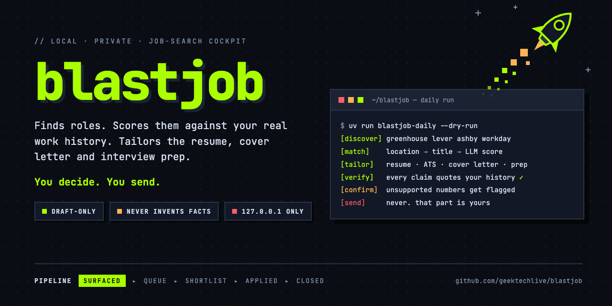

# blastjob

A local, private job-search cockpit. It **finds** roles, **scores** them against
your real work history, lets you **review** them in a browser, and **tailors** a
resume, cover letter and interview prep pack for the ones you keep.

- **Draft-only.** It never applies, sends, posts or messages anyone on your
  behalf. You decide and you send.
- **Never invents facts.** Every resume claim must quote your own work history;
  unsupported claims are flagged before you see the packet. The check is
  model-assisted, so read every packet before you send it.
- **Local-only.** It runs on your machine, binds to `127.0.0.1` by default, and
  keeps your data out of this repo.

The app ships empty: no candidate profile, no location, no target companies.
Follow the quick start below, or open [SETUP.md](SETUP.md) with an AI assistant
and let it walk you through the full setup interview.

## Quick start

You need macOS or Linux, Python 3.11 or newer, [uv](https://docs.astral.sh/uv/),
and one LLM: a logged-in [Claude Code](https://claude.ai/code) `claude` CLI (no
key needed), or an `ANTHROPIC_API_KEY` or `OPENAI_API_KEY`. PDF export also
needs pango (`brew install pango` on macOS); Markdown and DOCX work without it.
[Install blastjob](docs/getting-started/install.md) covers each step in detail.

1. Install, and check what's missing:

   ```bash
   git clone https://github.com/geektechlive/blastjob && cd blastjob
   uv sync --extra dev
   uv run blastjob setup doctor
   ```

   The doctor lists what still needs doing, with a fix for each item. Expect
   failures until you finish the steps below.

2. Create the secrets file, even if it stays empty for now. The one command is in
   [install](docs/getting-started/install.md#create-the-secrets-file).

3. Say what you're looking for and where you live (your own values here):

   ```bash
   uv run blastjob setup set candidate.target_titles '["Director of Data Engineering", "Head of Data"]'
   uv run blastjob setup set candidate.seniority "director"
   uv run blastjob setup set candidate.field "data engineering"
   uv run blastjob setup set discovery.home_location "Springfield, OH"
   uv run blastjob setup set discovery.home_state OH
   uv run blastjob setup set discovery.home_lat 39.92
   uv run blastjob setup set discovery.home_lon -83.81
   uv run blastjob setup set discovery.towns '{"springfield": [39.92, -83.81]}'
   uv run blastjob setup set discovery.remote_ok true
   ```

   Nothing is scored until `candidate.target_titles` is set. `discovery.towns`
   lists every town you'd work in, lowercased, with its coordinates. You can
   also fill these in on the cockpit's Settings page after step 5.

4. Optional: choose where your documents go. The default is
   `~/Documents/blastjob`, which syncs to iCloud on a Mac with "Desktop &
   Documents" turned on. To use another folder:

   ```bash
   uv run blastjob setup set paths.output_dir ~/blastjob-packets
   ```

5. Start the cockpit, then add your resumes at
   http://127.0.0.1:8765/work-history/ingest:

   ```bash
   uv run blastjob-web
   ```

   Read the merged work history it produces and correct it at `/work-history`.
   Every resume is built from it.

6. Add job sources on the Settings page (`/settings`) or with `setup set`:
   company job boards, job-alert email, Adzuna. The interview in
   [SETUP.md](SETUP.md) (section 3c) covers each one.

7. Optional, macOS: run discovery every morning and keep the cockpit always on
   with `sh scripts/install-launchd.sh`. See
   [Running the services](docs/operations/services.md), which also covers Linux.

Run `uv run blastjob setup doctor` again at any point. Once your work history
and target titles are in, the only items it still lists are for features you
haven't turned on.

## What it does

- **Ingest.** Upload your resumes (PDF, DOCX, text). They are merged into one
  deduplicated `work_history.md`, the source of truth for everything after. You
  review and correct it by hand.
- **Discover.** Polls public company job boards (Greenhouse, Lever, Ashby,
  Workday, Dayforce) and, optionally, the Adzuna aggregator, LinkedIn/Indeed
  job-alert emails over IMAP, retained search firms and Apple careers. Or add a
  posting by hand. No scraping, no browser automation.
- **Match.** An offline location filter (no maps API), a title prefilter, an LLM
  alignment score against your history, and a gate that surfaces strong fits and
  queues borderline ones. Unknown pay is shown, never silently dropped.
- **Pipeline.** Surfaced, Queue, Shortlist, Applied, Closed, with follow-ups,
  duplicate-posting clustering, and posting-closure checks that only move a job
  on proof.
- **Tailor.** Per-job resume (standard and ATS), cover letter, groundedness check,
  packet verification of the actual DOCX, and interview prep. Numbers that are not
  in your history are marked `[confirm]`.
- **Network.** Import your own LinkedIn data export to see who you know at each
  company. Message bodies are never stored.
- **Daily autopilot (optional).** A scheduled run that discovers, scores and sends
  a digest (Discord, stdout or off).

## Where your data lives

Everything blastjob knows about you lives on your own machine, in three places,
none of them inside this repository: the data dir (`~/.blastjob` by default, holding
your settings, jobs and work history in `blastjob.db` and `work_history.md`), a
secrets file for API keys and app passwords, and the output folder
(`~/Documents/blastjob` by default) with your resumes, cover letters and prep packs.
Your work history and each job description go to the LLM provider you chose; nothing
is ever submitted on your behalf. The full list of what each place holds, what leaves
your machine, backups and removal is in
[Your data and backups](docs/operations/data-and-backups.md).

The cockpit has no login. It binds `127.0.0.1` unless you choose otherwise; see [LAN access](docs/operations/lan-access.md).

## Where to go next

- [docs/README.md](docs/README.md): the documentation index, by what you want to do.
- [SETUP.md](SETUP.md): let an AI assistant set it up for you with the setup
  interview.
- [CONTRIBUTING.md](CONTRIBUTING.md): development setup, tests, the leak check and
  pull request rules.
- [SECURITY.md](SECURITY.md): how to report a vulnerability, and what blastjob is
  built to resist.
- [AGENTS.md](AGENTS.md): the rulebook for AI coding agents working in this repo.

## License

MIT. See [LICENSE](LICENSE).
